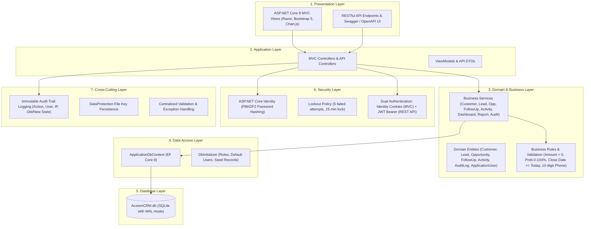

# AcxiomCRM - Enterprise Customer Relationship Management System

**AcxiomCRM** is an enterprise-grade, multi-tiered Customer Relationship Management application built with **ASP.NET Core 8 MVC**, **EF Core SQLite**, **ASP.NET Core Identity**, and **RESTful Web APIs**. It implements role-based access control (RBAC), end-to-end sales pipelines, atomic lead conversions, dynamic analytics dashboards, immutable audit logging, and automated reporting with CSV export.

---

## 1. System Architecture

AcxiomCRM strictly follows the 7-tier enterprise layered architecture:



---

## 2. Technology Stack

- **Framework**: .NET 8.0 (ASP.NET Core MVC & Web API)
- **Database & ORM**: Entity Framework Core 8.0 with SQLite
- **Security & Identity**: ASP.NET Core Identity with PBKDF2 hashing, cookie auth, JWT Bearer tokens
- **API Documentation**: Swagger / OpenAPI (Swashbuckle 6.6.2)
- **Frontend / UI**: Razor Views, Bootstrap 5.3, Bootstrap Icons, Chart.js 4.4, jQuery & jQuery Validation
- **Reporting**: Dynamic HTML Reports, CSV streaming export, Print-optimized CSS

---

## 3. Seeded Accounts & Credentials

The database is automatically created and pre-seeded on initial startup with the following three roles and test users:

| Role | Email | Password | Access Level |
| :--- | :--- | :--- | :--- |
| **Admin** | `admin@acxiomcrm.com` | `Admin@123!` | Full system access: User & Role management, Audit Logs, All Customers/Leads/Opps, Reports, API |
| **Manager** | `manager@acxiomcrm.com` | `Manager@123!` | Team-wide visibility: All Customers, Leads, Opportunities, Team Analytics, Reports, Audit Logs |
| **SalesExecutive** | `sales@acxiomcrm.com` | `Sales@123!` | Scoped access: Own assigned Customers, Leads, Opportunities, Follow-Ups, and Activities |

---

## 4. Key Functional Modules

### 4.1. Authentication & Security
- **Role-Based Access Control (RBAC)**: Managed via ASP.NET Core Identity roles (`Admin`, `Manager`, `SalesExecutive`).
- **Password Policy**: Minimum 8 characters, requires uppercase, lowercase, digit, and special character.
- **Account Lockout**: Automatically locks user account for 15 minutes after 5 consecutive failed login attempts.
- **Dual Authentication Architecture**:
  - Web UI routes use secure, HTTP-only anti-forgery protected Session Cookies.
  - REST API routes use cryptographically signed JWT Bearer tokens issued via `/api/auth/login`.

### 4.2. Interactive Analytics Dashboard (`/Dashboard`)
- **8 Real-Time KPI Cards**: Total Customers, Active Leads, Total Opportunities, Open Follow-Ups, Total Pipeline Value, Weighted Pipeline Value, Won Revenue, Conversion Rate (%).
- **Chart.js Visualizations**:
  - *Lead Distribution by Source* (Doughnut Chart)
  - *Opportunity Stage Pipeline Breakdown* (Bar Chart)
  - *Monthly Revenue Trend* (Line Chart)
- **Date Filters**: All Time, Today, This Week, This Month, This Quarter, This Year.

### 4.3. Customer Management (`/Customers`)
- Full CRUD operations with search, filtering, and pagination.
- **Validations**: Mandatory 10-digit phone regex (`^[0-9]{10}$`), unique email constraint, duplicate detection on name and email.
- **Ownership Scoping**: Sales executives only view and manage their assigned customers, while Managers and Admins access all records.

### 4.4. Lead Management & Conversion Pipeline (`/Leads`)
- Lead capture with Source (Website, Referral, Cold Call, Trade Show, Email Campaign, Social Media), Status (New, Contacted, Qualified, Proposal Sent, Converted, Lost), and Priority (Low, Medium, High).
- **Atomic Lead-to-Customer Conversion**:
  - Single-click conversion modal.
  - Automatically provisions a new Customer record from Lead data.
  - Optionally creates an initial Opportunity linked to the newly created Customer.
  - Marks the Lead as `Converted`, links `ConvertedCustomerId` and `ConvertedOpportunityId`, and logs the conversion in the Audit Trail.

### 4.5. Opportunity & Pipeline Management (`/Opportunities`)
- Sales pipeline stages: *Prospecting (10%)*, *Qualification (25%)*, *Proposal (50%)*, *Negotiation (75%)*, *Closed Won (100%)*, *Closed Lost (0%)*.
- **Enforced Business Validations**:
  - Deal Amount must be greater than zero (`Amount > 0`).
  - Win Probability must be an integer between 0 and 100 (`0 <= Probability <= 100`).
  - Expected Close Date cannot be set to a past date (`ExpectedCloseDate >= Today`).
  - Automatic calculation of Weighted Deal Value (`Amount * Probability / 100`).

### 4.6. Follow-Up Management (`/FollowUps`)
- Types: Call, Meeting, Email, Demonstration.
- Statuses: Planned, Completed, Missed, Cancelled.
- **Business Validations**: Planned follow-up date cannot be set in the past.
- Quick workflow actions: One-click "Mark as Completed" and "Reschedule".

### 4.7. Activity Management (`/Activities`)
- Logging of Calls, Meetings, Emails, and Tasks linked directly to Customers or Leads.
- Comprehensive activity history view with timestamp and user attribution.

### 4.8. User & Role Administration (`/Users` - Admin Only)
- User list with role tags, email confirmation status, and active indicators.
- One-click Activate / Deactivate user accounts.
- Account Unlock feature for users locked out due to excessive failed login attempts.
- Password reset capability for administrative support.

### 4.9. Immutable Audit Logging (`/AuditLogs` - Admin & Manager)
- Security and transaction logging for: `Login`, `Logout`, `Create`, `Update`, `Delete`, and `Convert`.
- Captures User ID, Email, IP Address, UTC Timestamp, Entity Name, Record ID, and Old/New Values.

### 4.10. Business Reports & CSV Export (`/Reports`)
- 8 Dedicated Analytical Reports:
  1. **Pipeline Summary Report**: Total and weighted pipeline value grouped by stage and owner.
  2. **Customer Directory Report**: Complete customer roster with contact and owner details.
  3. **Lead Status & Source Report**: Lead volume, status progression, and lead source efficacy.
  4. **Opportunity Stage Analysis Report**: Open and closed opportunities with deal sizes and probability.
  5. **Follow-Up Compliance Report**: Planned vs. completed vs. missed follow-ups.
  6. **Lead Conversion Report**: Total leads, converted leads, lead conversion rate (%), and won revenue.
  7. **User Activity Report**: Per-rep breakdown of leads, deals, follow-ups, activities, and logins.
  8. **Audit Trail Report**: Filterable log of all sensitive CRUD and security events.
- **Export & Print**:
  - One-click **Export to CSV** for all 8 reports.
  - Print-friendly layout (`window.print()`) with print stylesheets.

---

## 5. RESTful API & Swagger UI

Interactive Swagger documentation is available at **`http://localhost:5000/swagger`**.

### Endpoints Summary

| Method | Endpoint | Authorization | Description |
| :--- | :--- | :--- | :--- |
| `POST` | `/api/auth/login` | Anonymous | Authenticates credentials and returns JWT Bearer token |
| `GET` | `/api/customers` | Bearer Token | Retrieves paginated list of customers (supports search) |
| `GET` | `/api/customers/{id}` | Bearer Token | Retrieves a specific customer by ID |
| `POST` | `/api/customers` | Bearer Token | Creates a new customer with 10-digit phone and unique email validation |
| `PUT` | `/api/customers/{id}` | Bearer Token | Updates an existing customer |
| `DELETE`| `/api/customers/{id}` | Bearer Token | Deletes a customer (Admin / Manager) |
| `GET` | `/api/leads` | Bearer Token | Retrieves paginated list of leads |
| `POST` | `/api/leads` | Bearer Token | Creates a new lead |
| `PUT` | `/api/leads/{id}` | Bearer Token | Updates an existing lead |
| `DELETE`| `/api/leads/{id}` | Bearer Token | Deletes a lead |
| `GET` | `/api/opportunities` | Bearer Token | Retrieves opportunities with pipeline summary |
| `POST` | `/api/opportunities` | Bearer Token | Creates an opportunity (Validates amount > 0, prob 0-100, future date) |
| `PUT` | `/api/opportunities/{id}`| Bearer Token | Updates an opportunity |
| `DELETE`| `/api/opportunities/{id}`| Bearer Token | Deletes an opportunity |
| `GET` | `/api/followups` | Bearer Token | Retrieves follow-ups |
| `POST` | `/api/followups` | Bearer Token | Creates a follow-up (Validates date >= today) |
| `PUT` | `/api/followups/{id}` | Bearer Token | Updates a follow-up |
| `DELETE`| `/api/followups/{id}` | Bearer Token | Deletes a follow-up |
| `GET` | `/api/reports/pipeline`| Bearer Token | Retrieves pipeline summary report metrics |

### Obtaining and Using a JWT Token

1. Send POST request to `/api/auth/login`:
```json
POST /api/auth/login
Content-Type: application/json

{
  "email": "admin@acxiomcrm.com",
  "password": "Admin@123!"
}
```

2. Response payload:
```json
{
  "token": "eyJhbGciOiJIUzI1NiIsInR5cCI6...",
  "expiration": "2026-11-04T06:30:00Z",
  "userId": "...",
  "email": "admin@acxiomcrm.com",
  "fullName": "System Administrator",
  "role": "Admin"
}
```

3. Include the token in subsequent requests:
```http
Authorization: Bearer <token>
```

---

## 6. How to Run the Application

### Option A: Using the Launch Script (Recommended)
Double-click `run.bat` (or execute `run.ps1` in PowerShell). This will:
1. Configure environment variables for .NET 8.
2. Launch the web server on `http://localhost:5000`.
3. Open your default web browser directly to the login page.

### Option B: Using the Command Line
```powershell
$env:Path = "C:\Users\udhay\.dotnet;" + $env:Path
$env:DOTNET_CLI_HOME = "$pwd\.dotnet_home"
$env:NUGET_PACKAGES = "$pwd\.nuget_packages"
$env:ASPNETCORE_URLS = "http://localhost:5000"

cd AcxiomCRM
dotnet run --no-restore
```

Navigate to:
- **Web Application**: `http://localhost:5000`
- **Swagger Documentation**: `http://localhost:5000/swagger`

---

## 7. Automated Acceptance Tests & Verification

An end-to-end automated test runner is included in `tests/test_runner.ps1` (and `tests/run_tests.bat`). It validates all 14 assignment requirements against the live server:

1. **Anonymous Access Block**: Confirms unauthenticated access to `/Dashboard` is blocked and redirected (302) to `/Account/Login`.
2. **REST API Authentication**: Verifies `/api/auth/login` validates credentials and issues a signed JWT token.
3. **Customer API**: Confirms authenticated `GET /api/customers` returns seeded customer records.
4. **Lead API**: Confirms authenticated `GET /api/leads` returns seeded lead records.
5. **Opportunity API & Pipeline**: Confirms authenticated `GET /api/opportunities` calculates nominal and weighted pipeline values ($395,000 nominal / $330,000 weighted).
6. **Validation: Amount <= 0**: Rejects invalid opportunity amount with `HTTP 400 Bad Request`.
7. **Validation: Probability > 100**: Rejects probability > 100 with `HTTP 400 Bad Request`.
8. **Validation: Past Close Date**: Rejects past expected close date with `HTTP 400 Bad Request`.
9. **Validation: Past Follow-up Date**: Rejects planned follow-up in the past with `HTTP 400 Bad Request`.
10. **Swagger OpenAPI Endpoint**: Confirms `/swagger/v1/swagger.json` serves the valid OpenAPI v1 specification.

### Running the Test Suite:
```powershell
powershell -NoProfile -ExecutionPolicy Bypass -File "tests\test_runner.ps1"
```

---

## 8. Project Structure

```
AcxiomCRM/
├── Controllers/
│   ├── Api/
│   │   ├── AuthApiController.cs
│   │   ├── CustomersApiController.cs
│   │   ├── FollowUpsApiController.cs
│   │   ├── LeadsApiController.cs
│   │   ├── OpportunitiesApiController.cs
│   │   └── ReportsApiController.cs
│   ├── AccountController.cs
│   ├── ActivitiesController.cs
│   ├── AuditLogsController.cs
│   ├── CustomersController.cs
│   ├── DashboardController.cs
│   ├── FollowUpsController.cs
│   ├── HomeController.cs
│   ├── LeadsController.cs
│   ├── OpportunitiesController.cs
│   ├── ReportsController.cs
│   └── UsersController.cs
├── Data/
│   ├── ApplicationDbContext.cs
│   └── DbInitializer.cs
├── Models/
│   ├── Activity.cs
│   ├── ApplicationUser.cs
│   ├── AuditLog.cs
│   ├── Customer.cs
│   ├── FollowUp.cs
│   ├── Lead.cs
│   └── Opportunity.cs
├── Services/
│   ├── ActivityService.cs
│   ├── AuditService.cs
│   ├── CustomerService.cs
│   ├── DashboardService.cs
│   ├── FollowUpService.cs
│   ├── LeadService.cs
│   ├── OpportunityService.cs
│   └── ReportService.cs
├── ViewModels/
│   ├── AccountViewModels.cs
│   ├── ActivityViewModels.cs
│   ├── ApiDTOs.cs
│   ├── AuditLogViewModel.cs
│   ├── CustomerViewModels.cs
│   ├── DashboardViewModel.cs
│   ├── FollowUpViewModels.cs
│   ├── LeadViewModels.cs
│   ├── OpportunityViewModels.cs
│   ├── ReportViewModels.cs
│   └── UserViewModels.cs
├── Views/
│   ├── Account/
│   ├── Activities/
│   ├── AuditLogs/
│   ├── Customers/
│   ├── Dashboard/
│   ├── FollowUps/
│   ├── Home/
│   ├── Leads/
│   ├── Opportunities/
│   ├── Reports/
│   ├── Shared/
│   │   ├── _Layout.cshtml
│   │   ├── _ValidationScriptsPartial.cshtml
│   │   └── _ViewImports.cshtml
│   └── Users/
├── tests/
│   ├── test_runner.ps1
│   └── run_tests.bat
├── AcxiomCRM.csproj
├── appsettings.json
├── Program.cs
├── run.bat
├── run.ps1
└── README.md
```
